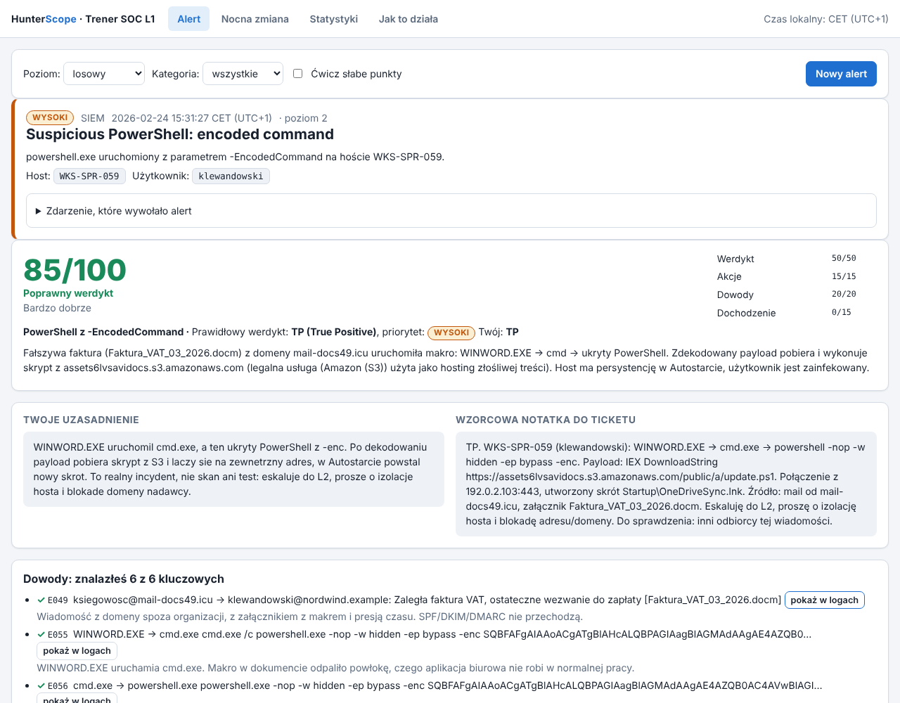

# HunterScope

[](https://github.com/barzim1/Hunterscope/actions/workflows/ci.yml)


**Identity-centric triage for SOC L1/L2.** Give it a user or a host and a time range; it returns an investigation
dossier: correlated detections mapped to MITRE ATT&CK, a risk score that shows its arithmetic, IOCs, a timeline, and
a pseudonymized export that is safe to paste into a ticket. A case store and a shift handover close the loop between
analysts.

It runs offline on log exports (Entra ID sign-ins, M365 audit log, Windows Security/Sysmon, `.eml`), so it can be
demonstrated without a SIEM and without anyone's real data.


## Why it exists

The repetitive part of L1 work is the same every time: pull the user's sign-ins, check the mail they received, look at
what their host ran, decide, write it up, mask the personal data, hand over to the next shift. HunterScope automates
the pulling, correlating and writing, and leaves the decision (and its justification) to the analyst.

## Try it (one minute)

```bash
git clone https://github.com/barzim1/Hunterscope.git && cd Hunterscope
python3 -m venv .venv && source .venv/bin/activate        # Windows: .venv\Scripts\activate
pip install -e .

hunterscope triage -i data/samples -u jkowalski                          # terminal dossier
hunterscope triage -i data/samples -u jkowalski -f html -o dossier.html  # standalone HTML report
hunterscope triage -i data/samples -u jkowalski --redact                 # USER_A, EXT_EMAIL_1, ...
hunterscope triage -i data/samples --ip 203.0.113.77                     # pivot: every account seen from this IP
```

`data/samples` is synthetic: one account taken over through a phishing mail (password spraying, MFA fatigue,
impossible travel, a forwarding rule, an OAuth consent, encoded PowerShell), and other accounts whose
look-alike-but-benign activity must stay quiet. Without installing anything:
[dossier](docs/examples/dossier-jkowalski.html), [redacted dossier](docs/examples/dossier-jkowalski-redacted.html),
[shift handover](docs/examples/handover.html) (download the file; GitHub shows the source).

Everything else is in `hunterscope --help`: `rules`, `explain`, `shift-summary`, `case`, `coverage`, `train`.
Full reference: [`docs/reference.md`](docs/reference.md).

## What it does

| | |
|---|---|
| **Ingest** | Entra ID sign-in logs, M365 Unified Audit Log, Windows Security and Sysmon (JSON), `.eml`. Bad records are counted, not fatal. |
| **Detect** | 12 rules: brute force that succeeded, password spraying across accounts from one IP, MFA fatigue, a sign-in property new to the account, impossible travel, off-hours logon, malicious inbox rules, OAuth consent, LSASS access, LotL command lines, suspicious email, and *phish followed by a sign-in from an IP never seen before*. Thresholds and weights are YAML. With `--sigma`, also the SigmaHQ Windows rules through a built-in Sigma evaluator. |
| **Score** | 0-100, and the report shows where every point came from: repeats count 25%, one rule is capped, multi-stage activity adds a bonus. |
| **Redact** | Deterministic pseudonyms (`USER_A`, `INTERNAL_IP_1`); PESEL only with a valid checksum; optional HMAC mode so labels are stable and not reversible by brute force. |
| **Cases** | SQLite. Closing or escalating needs a written reason, closed cases are immutable, every change is an append-only audit entry. |
| **Handover** | `shift-summary`: unresolved (flagged `STALE` after 24 h), escalated, closed FP/TP, each with the analyst's reason. |
| **Report** | Markdown, JSON, or one static HTML file: no JavaScript, no network requests, everything escaped. |
| **Explain** | Offline Polish knowledge base (113 entries: event ids, Entra codes, processes, M365 operations, ATT&CK techniques, rules) with source links. An unknown term is reported as unknown, never guessed. An optional LLM layer (`--llm`, off by default) runs only after pseudonymization, with `--dry-run` to see the payload. |


### Trainer

`hunterscope train` starts a local web UI that generates SIEM-style alerts with correlated logs, hides the verdict
and scores your decision as TP, benign TP or FP, then shows the key events, the red herrings and a model ticket note.
16 scenario types, three levels, a night-shift queue with a realistic FP-heavy mix. Standard library only, synthetic
data. Docs (Polish): [`docs/trainer.md`](docs/trainer.md).



A companion project, [ioc-enricher](https://github.com/barzim1/ioc-enricher), checks IPs, domains, URLs and hashes
against VirusTotal and AbuseIPDB and returns a score with its reasoning.

## How I checked it works

Synthetic scenarios prove the rules do what the code says; they do not prove the rules catch anything real. So the
Windows detections are measured against public, ATT&CK-labelled datasets
([OTRF Security-Datasets](https://github.com/OTRF/Security-Datasets): 98 datasets, ~750k events), split 50/50 by a
fixed hash into *dev* and *holdout*. Rules and the Sigma engine were developed on dev only. The split was fixed after
the first all-data numbers had been seen, so it is held out from rule design, not blind.

| Same 17 in-scope datasets | Dev | Holdout | All |
|---|---|---|---|
| Own command-line rules | 3 / 10 | 1 / 7 | 4 / 17 |
| + Sysmon 10 `lsass_access` | 5 / 10 | 3 / 7 | 8 / 17 |
| SigmaHQ rules alone (1,988 of 2,425 evaluable) | 8 / 10 | 6 / 7 | 14 / 17 |
| Own + Sigma | 8 / 10 | 6 / 7 | 14 / 17 |

Reading it honestly:

- **Tiny sample.** The 95% interval for the holdout result is wide (for 3 / 7 it is 16-75%); read counts, not
  percentages.
- **My own Windows rules add nothing beyond Sigma** (the union equals Sigma in every row). So Sigma is the Windows
  detection layer (`triage --sigma`) and the own rules are kept for what Sigma does not do: identity, phishing and
  cross-account correlation.
- **Precision is not measured.** The datasets have no benign baseline. About 60% of (dataset, rule) matches are
  off-label, which is a noise signal, not a false-positive rate.
- The Sigma protocol was committed before the engine ([`docs/sigma-protocol.md`](docs/sigma-protocol.md)); the
  exact-sub-technique check was added after seeing the first result, and the protocol says so.

Real data also found bugs synthetic data could not: older exports use `EventTime` instead of `TimeCreated` (whole
datasets were parsed as empty), and logon events 4624/4625 were read as the machine account instead of the target
user. Both are fixed and covered by tests. Full tables and every missed technique:
[`docs/coverage.md`](docs/coverage.md).

## Design decisions

- **Explainable over clever.** A number an analyst cannot audit is a number they will ignore.
- **Log content is untrusted input.** HTML output is escaped and sealed with `Content-Security-Policy: default-src
  'none'`; tests push `<script>` and `` through every field.
- **The decision stays human.** The tool refuses to close or escalate a case without a reason, because the next shift
  needs it more than the dashboard does.
- **Redaction states its limits.** It cannot find free-text names or unknown short hostnames, and keeps public IPs by
  default because they are IOCs. That is documented next to the feature.
- **Say what was not measured.** Holdout, ablation, confidence intervals, and a report that lists what is *not*
  detected.

## Limits

- **Not an EDR.** Most labelled techniques (WMI, injection, scheduled tasks, SMB/RDP lateral movement) have no rule of
  their own; Sigma covers part of them.
- **Identity and cloud rules are validated on synthetic data only**, because no public labelled dataset exists for
  them. That includes the cross-account spray rule (no finding on the one public spray dataset, which sits in the
  holdout and was deliberately not inspected) and the "new for this user" rule, which is weak by design: a business
  trip looks like an attack to it and it is silent without history.
- **The Sigma evaluator is a custom implementation**, tested against the specification and on 1,988 real rules but not
  cross-checked against pySigma. SigmaHQ rules are fetched (Detection Rule License 1.1), never committed.
- `lsass_access` needs Sysmon EventID 10 for lsass, which many production configurations filter out.
- Single-analyst SQLite on a local disk, offline files only (no live SIEM client), not hardened for production.
- **The LLM layer has only been tested against a stubbed client**, never the live API. Treat it as unproven.
- **The knowledge base was not checked line by line against the sources it links**, and the trainer's scenarios are
  synthetic; their tests cover scoring and generation, not real-world accuracy.

## Where to start reading

| To see | Open |
|---|---|
| How a rule is written and tested | `src/hunterscope/detect/rules.py`, `tests/test_detections.py` |
| How the score is computed | `src/hunterscope/score.py`, `config/rules.yaml` |
| The Sigma evaluator | `src/hunterscope/sigma/`, `docs/sigma-protocol.md` |
| How coverage is measured | `src/hunterscope/coverage.py`, `docs/coverage.md` |
| Redaction | `src/hunterscope/redactor.py`, `config/redactor.yaml` |

```
src/hunterscope/
  ingest/      parsers + loader (entra, ual, windows/sysmon, eml)  -> normalized Event
  detect/      rules.py (per-user, cross-account, baseline and meta rules), engine.py, sigma_rules.py
  sigma/       Sigma parser, log source mapping, rule set
  score.py  redactor.py  triage.py  casestore.py  handover.py  report.py  coverage.py  explain.py  llm.py  cli.py
  trainer/     scenarios/ (16 templates), scoring, store, server, static/ (UI)
  config/      rules.yaml, redactor.yaml, knowledge.yaml      templates/   Jinja2 (md, html)
tests/         pytest, 470 tests: each rule has positive and benign cases
scripts/       generate_samples.py, fetch_datasets.py, build_screenshots.py
docs/          reference.md, coverage.md (measured), sigma-protocol.md, trainer.md, examples/, img/
```

Develop with `pip install -e ".[dev]"`, then `ruff check . && pytest -q`. CI runs the same on Python 3.10 and 3.12.
